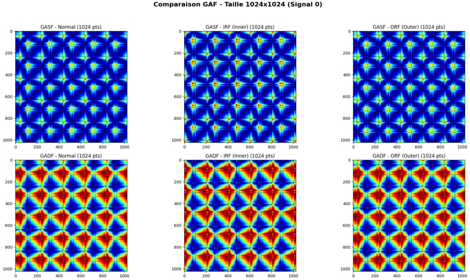
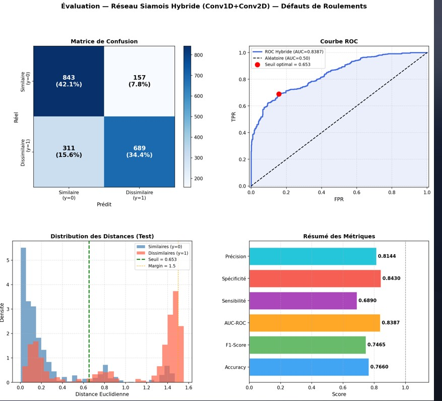
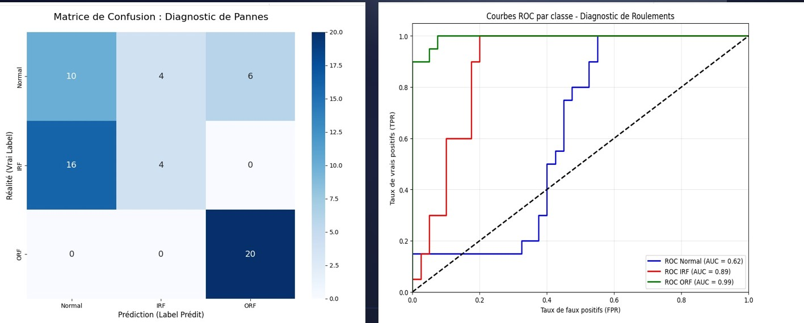
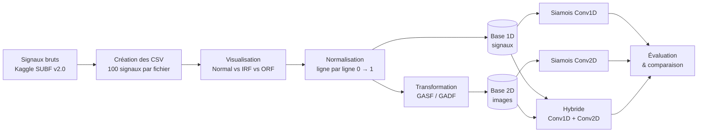

<div align="center">

# 🔧 Détection d'anomalies par réseaux siamois

### Défauts de roulements : signaux 1D vs images GASF / GADF
<div align="center">


</div>

*Une chaîne complète de traitement de signaux de vibration : base de données
expérimentale, normalisation, transformation en images (GASF / GADF),
réseaux siamois Conv1D et Conv2D, et comparaison des performances.*


</div>

---

## 📑 Sommaire

- [Aperçu](#-aperçu)
- [Démo](#-démo)
- [Pipeline](#-pipeline)
- [Données](#-données)
- [Réseaux siamois](#-réseaux-siamois)
- [Modèles implémentés](#-modèles-implémentés)
- [Résultats](#-résultats)
- [Stack technique](#-stack-technique)
- [Structure du dépôt](#-structure-du-dépôt)
- [Démarrage rapide](#-démarrage-rapide)
- [Perspectives](#-perspectives)
- [Équipe & contexte](#-équipe--contexte)

---

## 🔍 Aperçu

La détection de défauts de roulements est un enjeu majeur de la maintenance
industrielle. Ce projet utilise des **réseaux de neurones siamois**, qui
apprennent à mesurer la **similarité** entre deux signaux, pour distinguer
trois états d'un roulement :

- **Normal**
- **Inner Race Fault (IRF)** : défaut de la bague intérieure
- **Outer Race Fault (ORF)** : défaut de la bague extérieure

Le projet compare deux familles d'approches :

1. une approche **basée sur les signaux** (réseau siamois Conv1D),
2. une approche **basée sur les images** (réseau siamois Conv2D sur des
   représentations GASF et GADF), ainsi qu'un **modèle hybride** qui fusionne
   Conv1D et Conv2D.

---

## 🎬 Démo

### Images GASF et GADF


### Siamois Conv1D (Fusion conv1D et conv2D)

### Approche 2 — Siamois Conv2D -GASF



---

## 🔄 Pipeline



---

## 📦 Données

**Source :** [SUBF v2.0 — Bearing Faults Sound Data (Kaggle)](https://www.kaggle.com/datasets/sumairaziz/subf-v2-0-dataset-bearing-faults-sound-data)

### Base 1D — signaux

| Étape | Détail |
|---|---|
| Classes | Normal, Inner Race Fault (IRF), Outer Race Fault (ORF) |
| Fichiers CSV | Trois fichiers par mode, **100 signaux** tirés au hasard par fichier |
| Format | 1 ligne = 1 signal complet, 1 colonne = 1 échantillon (signaux de 2000 points) |
| Normalisation | **Ligne par ligne**, chaque signal est ramené entre 0 et 1 |

> ⚠️ Le `MinMaxScaler` de scikit-learn normalise **par colonne**. Comme chaque
> ligne est ici un signal indépendant, la normalisation est faite par ligne
> pour préserver la dynamique interne de chaque signal.

### Base 2D — images

Chaque signal normalisé est transformé en image avec la bibliothèque
[`pyts`](https://pyts.readthedocs.io/en/stable/) :

| Transformation | Principe |
|---|---|
| **GASF** (Gramian Angular Summation Field) | Somme angulaire, préserve les dépendances temporelles globales |
| **GADF** (Gramian Angular Difference Field) | Différence angulaire, met en évidence les changements brusques |

Les images sont générées en trois tailles pour comparer l'effet de la
résolution : **224×224**, **512×512** et **1024×1024**. Les modèles Conv2D
travaillent ensuite sur des images redimensionnées en **256×256** (niveaux de gris).

---

## 🧠 Réseaux siamois

Un réseau siamois est composé de **deux branches identiques qui partagent
les mêmes poids** (*weight sharing*). Chaque branche projette une entrée dans
un **espace d'embedding**, et une distance entre les deux embeddings mesure
leur similarité.

- **Paires similaires** (même classe) : la distance est minimisée
- **Paires dissimilaires** (classes différentes) : la distance est maximisée
- **Distance** : euclidienne ou différence absolue (L1) des embeddings
- **Fonction de perte** : *contrastive loss* (marge de 1,0) ou entropie croisée binaire sur la distance

Cette approche d'**apprentissage métrique** fonctionne avec très peu de
données : les modèles sont entraînés sur seulement **15 %** des données
(15 % pour la validation et 70 % pour le test), dans une logique de
**few-shot learning**.

---

## 🏗️ Modèles implémentés

| # | Modèle | Entrée | Classification |
|---|---|---|---|
| 1 | **Siamois Conv1D** | Signaux 1D normalisés (2000 points) | Binaire : normal vs anomalie |
| 2 | **Hybride Conv1D + Conv2D** | Signaux et images (fusion) | Binaire, puis 3 classes par k-NN sur les embeddings |
| 3 | **Siamois Conv2D — GADF** | Images GADF 256×256 | 3 classes, *few-shot* (5 images de référence par classe) |
| 4 | **Siamois Conv2D — GASF** | Images GASF 256×256 | 3 classes, paires par rapport à une référence saine |

### Encodeur Conv1D

Cinq blocs `Conv1D` (32 → 64 → 128 → 256 filtres, noyaux 7, 5 et 3) avec
`BatchNormalization`, `ReLU` et `MaxPooling1D`, suivis d'un embedding. La
distance euclidienne entre les deux embeddings est entraînée avec la
*contrastive loss* (optimiseur Adam, taux d'apprentissage 5e-5).

### Encodeur Conv2D (GADF)

Trois blocs `Conv2D` (32 → 64 → 128 filtres) avec `BatchNormalization` et
`MaxPooling`, un `GlobalAveragePooling2D`, puis un embedding de **128
dimensions normalisé (L2)**. Les deux embeddings sont comparés par leur
différence absolue, suivie de couches denses et d'une sortie sigmoïde.
En *few-shot*, une image est classée dans la classe dont les 5 références
sont en moyenne les plus proches.

### Analyse de l'espace d'embedding

Le notebook du modèle hybride visualise l'espace d'embedding avec **t-SNE**
et évalue la séparation des trois classes par un **k-NN** sur les embeddings.

---

## 📊 Résultats

| Modèle | Accuracy | F1-score | AUC |
|---|---|---|---|
| Siamois Conv1D (binaire) | 75,8 % | 0,66 | 0,774 |
| Hybride Conv1D + Conv2D (binaire) | 76,6 % | 0,747 | 0,839 |
| Hybride Conv1D + Conv2D (3 classes, k-NN) | 78,3 % | 0,786 (macro) | — |
| **Siamois Conv2D — GADF (3 classes, few-shot)** | **88 %** | — | **0,965** (moyenne) |
| Siamois Conv2D — GASF (3 classes) | 56,7 % | 0,53 | — |

**Lecture des résultats :**

- Les images **GADF** donnent de loin les meilleures performances : la
  différence angulaire met bien en évidence les chocs caractéristiques des
  défauts de roulement.
- Le modèle **hybride** améliore l'approche Conv1D seule (AUC de 0,774 à 0,839).
- Les images **GASF** donnent ici les résultats les plus faibles.

> ⚠️ Ces valeurs viennent de protocoles d'évaluation différents (classification
> binaire ou à 3 classes, jeux de test de tailles différentes). Elles montrent
> des tendances, mais ne sont pas strictement comparables entre elles.

Les matrices de confusion et les courbes ROC sont dans les notebooks.


---

## 🧰 Stack technique

<div align="center">

| Couche | Technologies |
|---|---|
| **Langage** | Python |
| **Deep Learning** | TensorFlow, Keras |
| **Machine Learning** | scikit-learn (métriques, t-SNE, k-NN) |
| **Séries temporelles** | pyts (GASF / GADF) |
| **Données** | NumPy, pandas |
| **Visualisation** | Matplotlib, Seaborn |
| **Environnement** | Google Colab |

</div>

---

## 📁 Structure du dépôt

```
Siamese-Bearing-Faults/
├── README.md
├── demo/                                   # Images de démonstration
│   ├── banner.png
│   ├── signaux.png
│   ├── gaf.png
│   └── roc.png
└── notebooks/
    ├── Géneration_des_images_GADF_et_GASF.ipynb       # Normalisation + génération des images
    ├── Conv1D_paire_siamese__.ipynb                   # Siamois Conv1D (signaux)
    ├── DonéesCSV_par_l_approche_de_fusion_Conv1D_Conv2D.ipynb   # Modèle hybride
    ├── Code_Finale_GADF_Ines_Gardabbou__1_.ipynb      # Siamois Conv2D (GADF)
    └── code_final_GASF.ipynb                          # Siamois Conv2D (GASF)
```

---

## 🚀 Démarrage rapide

Les notebooks ont été exécutés sur **Google Colab**, avec les données stockées
sur Google Drive.

1. Télécharge le dataset sur Kaggle (lien dans la section [Données](#-données)).
2. Ouvre les notebooks dans Colab, dans cet ordre :

| Ordre | Notebook | Rôle |
|---|---|---|
| 1 | `Géneration_des_images_GADF_et_GASF` | Normalisation et génération des images |
| 2 | `Conv1D_paire_siamese__` | Approche signaux |
| 3 | `DonéesCSV_par_l_approche_de_fusion_Conv1D_Conv2D` | Approche hybride |
| 4 | `Code_Finale_GADF_Ines_Gardabbou__1_` | Approche images GADF |
| 5 | `code_final_GASF` | Approche images GASF |

3. Adapte les chemins Google Drive au début de chaque notebook
   (`BASE_PATH`, chemins des CSV).

Pour une exécution en local :

```bash
pip install tensorflow scikit-learn pyts numpy pandas matplotlib seaborn
jupyter notebook
```

---

## 🔭 Perspectives

- Optimisation des hyperparamètres et enrichissement du jeu de données
- Exploration d'architectures de type **Transformer** pour les séries temporelles
- Déploiement sur systèmes embarqués pour une surveillance en temps réel

---

## 👥 Équipe & contexte

Projet semestriel (classe **IA22**), année académique **2025-2026**.

> Ines Gardabbou

> Mariam Gafsi

> Nawres Rabbeg

Encadré par **Mr Tarek Aroui**.

---
